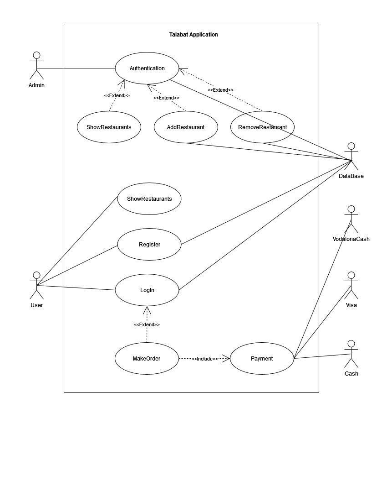

# Talabat

A console-based Java simulation of the Talabat food-ordering app, built as a CSE2 course project. Customers browse restaurants, view menus, place orders and choose a payment method; an admin manages the restaurant list.

The project follows a layered design (BAO / DAO / DTO) with interface-driven services and singleton data stores. It runs entirely in memory and requires no database.

## Features

**Customer**
- Register (unique email; name, email, password, location and phone are validated) and log in / out
- List all restaurants with name, location, hotline, cuisine type, working hours and a live **OPEN / CLOSE** status
- Open a restaurant's menu image and place an order by item code and quantity
- Choose a payment method: Visa, Vodafone Cash or cash
- View order history

**Admin**
- Authenticate with email and password
- Add or edit a restaurant (matched by name)
- Remove a restaurant by hotline
- List all restaurants

## Architecture

| Layer | Package | Responsibility |
|---|---|---|
| Console UI | `Main` | Menu loop, input handling, sample data seeding |
| Business logic | `BAO` | `User` and `Admin` (behind `UserInterface` / `AdminInterface`): authentication, ordering, payment |
| Data access | `DAO` | `AllResturants` and `AllUsers`: in-memory stores exposed as singletons through `AllRestaurantsFactory` / `AllUsersFactory` |
| Data objects | `DTO` | `restaurant`, `item`, `order`, `reqItem` |

Each placed order is stored in the user's order history and queued on the chosen restaurant.

## Getting started

### Prerequisites
- JDK 14 or later (the code uses arrow-style `switch`); verified on JDK 21
- A desktop environment, since menus are opened with `java.awt.Desktop`

### Build and run

From the repository root:

```bash
cd "Talabat V2.2/Talabat"
mkdir -p out
javac -d out $(find src -name '*.java')
java -cp out Main
```

Alternatively, open `Talabat V2.2` in IntelliJ IDEA and run `Main`.

### Load the restaurant menus

Menu images are opened from file paths set in `Main.java` (currently `d:\...`, i.e. Windows-specific). To see menus:

1. Copy the images from [`Menus modified/`](Menus%20modified) to a local folder.
2. Update the `new File("...")` paths in `Main.java` to point to them.

| Image | Restaurant |
|---|---|
| `1.jpg` | Combo |
| `2.jpg` | AL-Menshawy |
| `3.jpg` | Wrap |
| `4.jpg` | Sultan El-Sham |
| `5.jpg` | El-Bakry |

The numbers printed on each menu image are the **item codes** to enter when ordering. If a menu file cannot be opened, the app prints a message and the order flow still works.

### Accounts

- **Customers:** choose *User → Register*, or use the sample accounts seeded in `Main.java`.
- **Admin:** credentials are hardcoded in `BAO/Admin.java` (demo only).

## Usage example

1. Run the app and choose `2` (User), then `3` (Log in).
2. Choose `2` (choose restaurant), enter a restaurant index and answer `Y` to order.
3. Enter an item code and quantity, then `0` to finish.
4. The total is shown; pick a payment method.
5. Choose `3` to see your orders, or `4` to log out.

## Repository layout

```
Talabat V2.2/Talabat/src/   Java sources (BAO, DAO, DTO, Main)
Menus modified/             Menu images annotated with item codes
UML/                        Use case, class and sequence diagrams
SRS_Talabat.pdf             Software Requirements Specification (v1.0)
```

## Design documentation

The requirements are in [`SRS_Talabat.pdf`](SRS_Talabat.pdf). Diagrams are in [`UML/`](UML).

**Use cases**



**Class diagram**


Sequence diagrams: [Make order](UML/SequenceDiagram_MakeOrder.jpg) · [Register](UML/SequenceDiagram_Register.jpg) · [Print all restaurants](UML/SequenceDiagram_PrintAllRestaurants.jpg) · [Remove restaurant](UML/SequenceDiagram_RemoveRestaurant.jpg)

## Known limitations

- **No persistence:** all data lives in memory and resets on exit.
- **Simulated payments:** card and Vodafone checks only validate number length; cash orders are recorded as unpaid.
- **Hardcoded credentials and data:** admin login and sample users/menus are defined in source.
- **Sample menu data:** Sultan El-Sham's seeded items (24) only partly match its menu image (codes up to 32).
- **Platform assumptions:** menu image paths are Windows-style, and menu viewing needs a GUI.
## Team

- Abd El-Rahman Ahmed Abd Rab El-Nabi
- Abd El-Rahman Mohammed Hassan
- Doha Ragab Abd El-Hamid
- Eman Kamel Ashry
- Mohammed Abd El-Rahman Mahmoud
